<p align="center">
  
  
  
  <a href="https://github.com/x2Swiftyouz/x2Swiftyouz/actions/workflows/ci.yml"></a>
  <a href="https://x2swiftyouz.github.io/x2Swiftyouz/"></a>
</p>

<a href="https://github.com/x2Swiftyouz">
  <picture>
    <source media="(prefers-color-scheme: dark)" srcset="dark_mode.svg">
    <source media="(prefers-color-scheme: light)" srcset="light_mode.svg">
    
  </picture>
</a>

### 👨‍💻 About me

```python
class Developer:
    name     = "x2swiftz_z"
    location = "Sakon Nakhon, Thailand 🇹🇭"
    code     = ["Python", "PowerShell"]
    tools    = ["VS Code", "Git", "GitHub Actions"]
    building = ["Discord bots", "Akati-Os"]
    learning = ["Python", "Git", "GitHub Actions"]

    def say_hi(self):
        print("Thanks for dropping by! 🚀")


Developer().say_hi()
```

### 🛠️ Tech stack

<p>
  
</p>

<!-- Discord status, shown when discord_id is set in profile.json -->
<!--START_SECTION:discord-->

<!--END_SECTION:discord-->

### 🚀 Projects

<!-- Filled automatically by scripts/generate.py: the most recently updated repos -->
<!--START_SECTION:projects-->
<p align="center">
<a href="https://github.com/x2Swiftyouz/Akati-Os"><picture><source media="(prefers-color-scheme: dark)" srcset="cards/Akati-Os_dark.svg"></picture></a>
<a href="https://github.com/x2Swiftyouz/Reshade-auto-installation"><picture><source media="(prefers-color-scheme: dark)" srcset="cards/Reshade-auto-installation_dark.svg"></picture></a>
<a href="https://github.com/x2Swiftyouz/Bot-Ai-Discord"><picture><source media="(prefers-color-scheme: dark)" srcset="cards/Bot-Ai-Discord_dark.svg"></picture></a>
<a href="https://github.com/x2Swiftyouz/Bot-Music"><picture><source media="(prefers-color-scheme: dark)" srcset="cards/Bot-Music_dark.svg"></picture></a>
</p>
<!--END_SECTION:projects-->

### 📝 Latest commits

<!-- Filled automatically by scripts/generate.py from each repo's default branch -->
<!--START_SECTION:commits-->
- 📝 [`6ab02bf`](https://github.com/x2Swiftyouz/Akati-Os/commit/6ab02bf332ac39f218d385707333d6c8458e323a) **Akati-Os** — v1.14.0 · <sub>9d ago</sub>
- 📝 [`734c5b9`](https://github.com/x2Swiftyouz/Akati-Os/commit/734c5b9bda5f67c3beb809264ead1841178d81ff) **Akati-Os** — Center: setup report, game runtimes, Akati settings export, Start here · <sub>9d ago</sub>
- 📝 [`3a236ef`](https://github.com/x2Swiftyouz/Akati-Os/commit/3a236efc61cb254fd00eeacb7a013c62c5edb102) **Akati-Os** — Work in progress · <sub>9d ago</sub>
- 📝 [`54e2f4a`](https://github.com/x2Swiftyouz/Akati-Os/commit/54e2f4a9da196794e632fb1476402bff7fc2a2cd) **Akati-Os** — Work in progress · <sub>9d ago</sub>
- 📝 [`cea92e3`](https://github.com/x2Swiftyouz/Reshade-auto-installation/commit/cea92e393f26eaf4db5c21d3dd4664f912b473c4) **Reshade-auto-installation** — Remove the Effects and Presets pages from the window · <sub>13d ago</sub>
- 📝 [`140b4fa`](https://github.com/x2Swiftyouz/Reshade-auto-installation/commit/140b4fad4ab05c0acea31ee3067bff57efb113e0) **Reshade-auto-installation** — Remove shortcut, screenshot folder, backups and weekly update check · <sub>13d ago</sub>
<!--END_SECTION:commits-->

### 📡 Recent activity

<!-- Filled automatically by scripts/generate.py from public GitHub events -->
<!--START_SECTION:activity-->
- 🔀 Opened PR [#45](https://github.com/x2Swiftyouz/Akati-Os/pull/45) in [x2Swiftyouz/Akati-Os](https://github.com/x2Swiftyouz/Akati-Os) · <sub>19h ago</sub>
- 🔀 Opened PR [#44](https://github.com/x2Swiftyouz/Akati-Os/pull/44) in [x2Swiftyouz/Akati-Os](https://github.com/x2Swiftyouz/Akati-Os) · <sub>9d ago</sub>
- 🔀 Opened PR [#43](https://github.com/x2Swiftyouz/Akati-Os/pull/43) in [x2Swiftyouz/Akati-Os](https://github.com/x2Swiftyouz/Akati-Os) · <sub>9d ago</sub>
<!--END_SECTION:activity-->

<!-- Newest posts from devlog/, shown once there is one -->
<!--START_SECTION:devlog-->

<!--END_SECTION:devlog-->

<!-- Codewars rank, shown when codewars_user is set in profile.json -->
<!--START_SECTION:codewars-->

<!--END_SECTION:codewars-->

<!-- AniList card, shown when anilist_user is set in profile.json -->
<!--START_SECTION:anime-->

<!--END_SECTION:anime-->

### 🐍 Contributions

<picture>
  <source media="(prefers-color-scheme: dark)" srcset="https://raw.githubusercontent.com/x2Swiftyouz/x2Swiftyouz/output/github-snake-dark.svg">
  <source media="(prefers-color-scheme: light)" srcset="https://raw.githubusercontent.com/x2Swiftyouz/x2Swiftyouz/output/github-snake.svg">
  
</picture>


